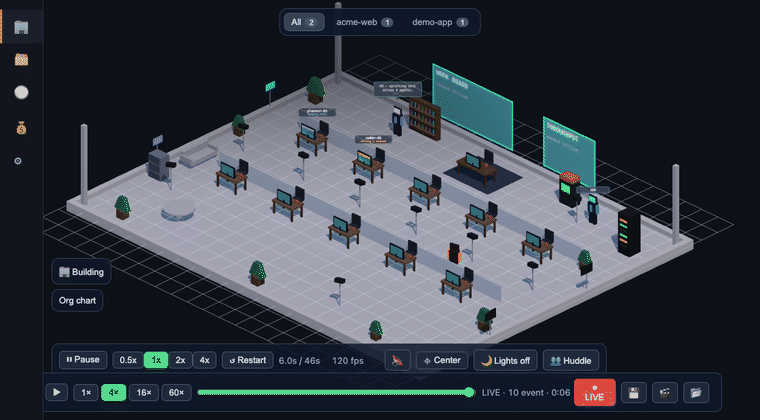

# Agent Office

**English** · [Tiếng Việt](README.vi.md)

[](https://github.com/h3nryprod01/agent-office/actions/workflows/ci.yml)
[](LICENSE)
[](https://nodejs.org)

**Stop babysitting your coding agents: see who is waiting on you, and approve from your phone.**

Agent Office is a local daemon plus a web UI. It reads your coding-agent sessions from disk, shows each one as a character in an isometric office, and puts the ones that need you at the top of a queue. A permission request can be answered from the office or from Telegram.



## Quick start

Requires Node 20+.

```bash
git clone https://github.com/h3nryprod01/agent-office && cd agent-office
./scripts/start.sh
```

It installs dependencies, builds the renderer and opens **http://localhost:8787**. If no daemon is running it asks whether to install one as a login service; answer no and it runs in the terminal until Ctrl+C. `--yes` answers yes.

No agent session running yet? The office offers **See a sample**: a scripted demo, always labelled *SAMPLE DATA*, that steps aside the moment a real session appears.

A one-command `npx` package is built and tested from a local tarball but **is not published to npm yet** (the package name is still open). See [docs/install.md](docs/install.md#from-a-packed-tarball-npx-package).

> Open it at `localhost`, not `127.0.0.1`: browsers keep separate permissions per origin, and the microphone grant voice input needs does not carry across.

**Windows:** `powershell -ExecutionPolicy Bypass -File scripts\start.ps1`. Parsed and dry-run on pwsh; **not yet run on a real Windows machine** end to end. **Linux:** `./scripts/install-ubuntu.sh`. More in [docs/install.md](docs/install.md).

## What it does

- **Waiting-on-you queue** — blocked, waiting and errored agents listed across every repo, with OS notifications. [Mission Control](docs/mission-control-status.md)
- **Approve permission requests** from the office or from Telegram buttons. Needs a `PermissionRequest` hook; setting it up is manual today. [Approve gateway](docs/approve-spike-status.md) · [Telegram](docs/multi-pm-telegram.md)
- **Per-project approval modes** with an audit trail, and per-project data rules. [Approval policy](docs/approval-policy.md)
- **Time-to-intervene numbers** (median, p90, count) and a radar that flags two agents editing the same files. [Radar](docs/radar.md)
- **The office** — characters walk to a desk, bookshelf, arcade machine or meeting table depending on what they are doing; org chart and one-floor-per-repo building view. [Semantic mapping](docs/semantic-mapping.md)
- **A PM agent per project** you can chat with, by text, voice or Telegram. [Per-project PM](docs/pm-per-repo-status.md) · [Voice](docs/voice-status.md)
- **Replay** of a session timeline. [Replay](docs/replay-status.md)
- **Spend** per session in tokens, and in USD for models with published pricing. [Cost dashboard](docs/cost-dashboard-status.md)
- **Presentation mode** that masks project names, paths and chat text before any view sees them. [Presentation mode](docs/presentation-mode.md)
- **Team templates** — rosters of agent roles plus goals you can list, apply and save back. [Templates](docs/company-templates.md)
- **Worker lanes** — Claude Code pointed at another vendor's model shows up with its own lane. [Worker lanes](docs/worker-lanes.md)
- **LAN access with tokens and roles**, and an `ao` CLI for `doctor`, `backup`, `update`, `restore`. [On-prem guide](docs/onprem.md)
- The UI is **English by default and Vietnamese on request**.

## Which agents it reads

| Source | Status |
|---|---|
| Claude Code | Verified on the current version |
| Claude Code on other model endpoints (worker lanes) | Verified |
| Hermes | Verified. Needs Node 22.13 or newer (it reads Hermes' SQLite store with `node:sqlite`) |
| Codex desktop app | Partly works: newer rollout files are `.jsonl.zst`, which the reader cannot open yet |
| Codex CLI | Experimental, not verified on the current version |
| Gemini CLI | Experimental, not verified on a real session. Google has moved Gemini CLI users to `agy`, which has no adapter yet |

How each was checked, and when: [docs/adapters-verified.md](docs/adapters-verified.md).

## Privacy and security

- It reads transcripts under your home directory and does not write to them. It writes only its own state: `~/.agent-office`; backups in `~/agent-office-backups`; the PM's session file under `.claude/memory/` of its workspace (the repo when run from a clone, `~/.agent-office/workspace` from the npm package); and, if you install the optional hooks, a hook log at `~/.claude/agent-office-hook-events.jsonl`.
- The daemon's only built-in network clients are for Telegram and Zalo, and they stay off until you set their tokens.
- It listens on `127.0.0.1` unless you switch on LAN mode, which requires a token for every non-local request. Plain HTTP on a LAN means tokens can be sniffed; read [SECURITY.md](SECURITY.md) before exposing the port.

## Known limits

- Zalo support follows Zalo's documentation and has **not been run against a real Official Account**.
- The Telegram channel is tested against a fake Telegram server, **not yet against a real bot**.
- `waiting_permission` needs a hook; without one the office cannot tell a permission prompt from a slow tool.
- Text-to-speech for PM replies needs a local virtualenv; without it the feature is simply off.

## Architecture

```
DATA SOURCES (read-only)
  ~/.claude/projects/**/*.jsonl             Claude Code transcripts (root + sub-agents)
  ~/.codex/sessions/**/rollout-*.jsonl      Codex (experimental)
  ~/.gemini/tmp/**                          Gemini CLI (experimental)
  ~/.claude/agent-office-hook-events.jsonl  hooks (optional, for instant signals)
        │ tail + normalize into one event stream
        ▼
  packages/daemon (plain Node; the only dependency is `ws`)
        │ WebSocket + HTTP on localhost:8787
        ▼
  packages/renderer (three.js isometric office and UI)
```

The event protocol lives in `packages/protocol`. The daemon only reads session data and the renderer only consumes it, so a new harness is an adapter, not a rewrite. Real data over pretty graphics: sample data is never shown unlabelled.

## Repo structure

- `packages/daemon/` — transcript and hook tailers, HTTP/WebSocket server, `ao` CLI code
- `packages/renderer/` — three.js renderer and UI
- `packages/protocol/` — event protocol
- `templates/` — agent rosters
- `docs/` — reference docs and a status note per feature ([index](docs/README.md))
- `assets/` — art, with sources and licenses in [assets/CREDITS.md](assets/CREDITS.md)

## Contributing

Issues welcome, including "this didn't work on my machine". Replies are best-effort. Please open an issue before building anything substantial. See [CONTRIBUTING.md](CONTRIBUTING.md).

## License

MIT — see [LICENSE](LICENSE). Third-party art is CC0; see [assets/CREDITS.md](assets/CREDITS.md).

Agent Office is an independent project. It is not affiliated with, endorsed by, or sponsored by Anthropic, OpenAI, Google, Telegram or Zalo. Product names belong to their owners and are used only to say what the tool reads or talks to.
