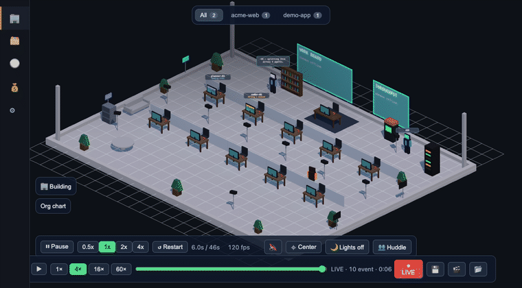

# Agent Office

[English](README.md) · **Tiếng Việt**

[](https://github.com/h3nryprod01/agent-office/actions/workflows/ci.yml)
[](LICENSE)
[](https://nodejs.org)

**Đừng ngồi trông agent code nữa: xem agent nào đang chờ bạn, và duyệt ngay từ điện thoại.**

Agent Office là một daemon chạy trên máy bạn cùng giao diện web. Nó đọc các phiên agent code từ ổ đĩa, vẽ mỗi phiên thành một nhân vật trong văn phòng isometric, và đưa những phiên cần bạn lên đầu hàng đợi. Một yêu cầu cấp quyền có thể được trả lời ngay trong văn phòng hoặc qua Telegram.



## Bắt đầu nhanh

Cần Node 20+.

```bash
git clone https://github.com/h3nryprod01/agent-office && cd agent-office
./scripts/start.sh
```

Script cài phụ thuộc, build renderer và mở **http://localhost:8787**. Nếu chưa có daemon nào chạy, nó hỏi có muốn cài daemon làm dịch vụ chạy khi đăng nhập không; trả lời không thì daemon chạy ngay trong terminal cho tới khi bạn bấm Ctrl+C. Cờ `--yes` là trả lời có.

Chưa có phiên agent nào đang chạy? Văn phòng đưa ra nút **Xem bản mẫu**: một kịch bản demo, luôn gắn nhãn *DỮ LIỆU MẪU*, tự nhường chỗ ngay khi có phiên thật.

Gói `npx` một lệnh đã được dựng và kiểm từ tarball cục bộ nhưng **chưa phát hành lên npm** (tên gói chưa chốt). Xem [docs/install.md](docs/install.md#from-a-packed-tarball-npx-package).

> Mở bằng `localhost`, đừng dùng `127.0.0.1`: trình duyệt cấp quyền riêng cho từng origin nên quyền micro mà nhập giọng nói cần sẽ không áp dụng cho địa chỉ IP.

**Windows:** `powershell -ExecutionPolicy Bypass -File scripts\start.ps1`. Đã kiểm cú pháp và chạy thử trên pwsh; **chưa chạy trọn trên máy Windows thật**. **Linux:** `./scripts/install-ubuntu.sh`. Chi tiết trong [docs/install.md](docs/install.md).

## Nó làm được gì

- **Hàng đợi "đang chờ bạn"** — agent bị chặn, đang chờ và gặp lỗi, gom từ mọi repo, kèm thông báo của hệ điều hành. [Mission Control](docs/mission-control-status.md)
- **Duyệt yêu cầu cấp quyền** ngay trong văn phòng hoặc bằng nút trên Telegram. Cần hook `PermissionRequest`: lệnh `node scripts/ao.mjs approvals setup` (từ gói npm: `waitchime approvals setup` sau khi `npm i -g`) thêm hook (có sao lưu và `--dry-run`) và ghép cặp bot Telegram. Đã thử với máy chủ Telegram giả, chưa thử với bot thật. Mỗi dự án có thể bật lá chắn dữ liệu cá nhân để che số điện thoại, số CCCD/CMND và email trong tin nhắn. [Approve gateway](docs/approve-spike-status.md) · [Telegram](docs/multi-pm-telegram.md)
- **Chế độ duyệt theo từng dự án** có nhật ký kiểm toán, cùng quy tắc dữ liệu theo dự án. [Chính sách duyệt](docs/approval-policy.md)
- **Số đo thời gian chờ** (trung vị, p90, số lần) và radar báo khi hai agent cùng sửa một file. [Radar](docs/radar.md)
- **Văn phòng** — nhân vật đi tới bàn làm việc, giá sách, máy arcade hoặc bàn họp tuỳ việc đang làm; sơ đồ tổ chức và toà nhà mỗi repo một tầng. [Ánh xạ ngữ nghĩa](docs/semantic-mapping.md)
- **Một PM agent cho mỗi dự án** để bạn trò chuyện bằng chữ, giọng nói hoặc Telegram. [PM theo dự án](docs/pm-per-repo-status.md) · [Giọng nói](docs/voice-status.md)
- **Phát lại** dòng thời gian của một phiên. [Phát lại](docs/replay-status.md)
- **Chi phí** theo phiên bằng token, và bằng USD với các model có bảng giá công bố. [Bảng chi phí](docs/cost-dashboard-status.md)
- **Chế độ trình chiếu** che tên dự án, đường dẫn và nội dung chat trước khi bất kỳ màn hình nào thấy. [Chế độ trình chiếu](docs/presentation-mode.md)
- **Template đội** — danh sách vai trò agent kèm mục tiêu, có thể liệt kê, áp dụng và lưu lại. [Template](docs/company-templates.md)
- **Làn worker** — Claude Code trỏ tới model của hãng khác hiện ra với làn riêng. [Làn worker](docs/worker-lanes.md)
- **Truy cập LAN có token và vai trò**, cùng CLI `ao` với `doctor`, `backup`, `update`, `restore`. [Hướng dẫn on-prem](docs/onprem.vi.md)
- Giao diện **mặc định tiếng Anh, có tiếng Việt khi bạn chọn**.

## Nó đọc được agent nào

| Nguồn | Trạng thái |
|---|---|
| Claude Code | Đã kiểm trên bản hiện hành |
| Claude Code trỏ tới endpoint model khác (làn worker) | Đã kiểm |
| Hermes | Đã kiểm. Cần Node 22.13 trở lên (đọc kho SQLite của Hermes bằng `node:sqlite`) |
| Ứng dụng Codex trên máy tính | Chạy một phần: file rollout mới có đuôi `.jsonl.zst`, bộ đọc chưa mở được |
| Codex CLI | Thử nghiệm, chưa kiểm trên bản hiện hành |
| Gemini CLI | Thử nghiệm, chưa kiểm trên phiên thật. Google đã chuyển người dùng Gemini CLI sang `agy`, chưa có adapter cho `agy` |

Cách kiểm và ngày kiểm từng nguồn: [docs/adapters-verified.md](docs/adapters-verified.md).

## Riêng tư và bảo mật

- Nó đọc transcript trong thư mục home của bạn và không ghi vào đó. Nó chỉ ghi trạng thái của chính nó: `~/.agent-office`; bản sao lưu ở `~/agent-office-backups`; file phiên của PM trong `.claude/memory/` của thư mục làm việc (chính repo khi chạy từ bản clone, `~/.agent-office/workspace` khi chạy từ gói npm); và nếu bạn cài hook tuỳ chọn thì có log hook ở `~/.claude/agent-office-hook-events.jsonl`. `approvals setup` sửa `~/.claude/settings.json` sau khi hỏi, có sao lưu.
- Kết nối mạng dựng sẵn của daemon chỉ có cho Telegram và Zalo, và chúng tắt cho tới khi bạn đặt token.
- Nó chỉ nghe trên `127.0.0.1` trừ khi bạn bật chế độ LAN, khi đó mọi yêu cầu không phải từ máy này đều cần token. HTTP trần trong LAN nghĩa là token có thể bị nghe lén; đọc [SECURITY.md](SECURITY.md) trước khi mở cổng ra ngoài.
- Đọc gì, lưu gì, gửi gì ra khỏi máy: [PRIVACY.md](PRIVACY.md). Giấy phép bên thứ ba: [THIRD_PARTY_NOTICES.md](THIRD_PARTY_NOTICES.md).

## Giới hạn đã biết

- Hỗ trợ Zalo làm theo tài liệu của Zalo và **chưa chạy với một Official Account thật**.
- Kênh Telegram được kiểm với máy chủ Telegram giả, **chưa kiểm với bot thật**.
- `waiting_permission` cần một hook; thiếu hook thì văn phòng không phân biệt được hộp thoại cấp quyền với một công cụ chạy chậm.
- Đọc to câu trả lời của PM cần một virtualenv cục bộ; không có thì tính năng đơn giản là tắt.

## Kiến trúc

```
NGUỒN DỮ LIỆU (chỉ đọc)
  ~/.claude/projects/**/*.jsonl             transcript Claude Code (gốc + sub-agent)
  ~/.codex/sessions/**/rollout-*.jsonl      Codex (thử nghiệm)
  ~/.gemini/tmp/**                          Gemini CLI (thử nghiệm)
  ~/.claude/agent-office-hook-events.jsonl  hook (tuỳ chọn, để có tín hiệu tức thì)
        │ đọc đuôi + chuẩn hoá thành một luồng sự kiện
        ▼
  packages/daemon (Node thuần; phụ thuộc duy nhất là `ws`)
        │ WebSocket + HTTP trên localhost:8787
        ▼
  packages/renderer (văn phòng isometric three.js và giao diện)
```

Giao thức sự kiện nằm ở `packages/protocol`. Daemon chỉ đọc dữ liệu phiên và renderer chỉ tiêu thụ, nên thêm một hãng mới là viết adapter chứ không phải viết lại. Dữ liệu thật hơn đồ hoạ đẹp: dữ liệu mẫu không bao giờ hiện mà không có nhãn.

## Cấu trúc repo

- `packages/daemon/` — bộ đọc transcript và hook, máy chủ HTTP/WebSocket, mã của CLI `ao`
- `packages/renderer/` — renderer three.js và giao diện
- `packages/protocol/` — giao thức sự kiện
- `templates/` — danh sách vai trò agent
- `docs/` — tài liệu tham chiếu và ghi chú trạng thái cho từng tính năng ([mục lục](docs/README.md))
- `assets/` — đồ hoạ, nguồn và giấy phép ở [assets/CREDITS.md](assets/CREDITS.md)

## Đóng góp

Hoan nghênh issue, kể cả "trên máy mình không chạy". Phản hồi theo khả năng. Hãy mở issue trước khi làm việc lớn. Xem [CONTRIBUTING.md](CONTRIBUTING.md).

## Giấy phép

MIT — xem [LICENSE](LICENSE). Đồ hoạ bên thứ ba là CC0; xem [assets/CREDITS.md](assets/CREDITS.md).

Agent Office là một dự án độc lập. Nó không liên kết với, không được xác nhận hay bảo trợ bởi Anthropic, OpenAI, Google, Telegram hay Zalo. Tên sản phẩm thuộc về chủ sở hữu và chỉ được dùng để nói công cụ đọc hoặc kết nối tới cái gì.
