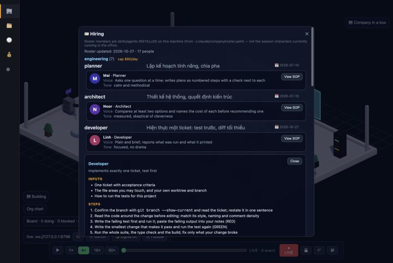
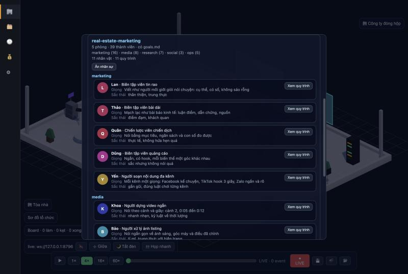

# Company templates

A template is a company in a box: one `roster.yaml` (who is on the multi-agent
team), one `goals.md` (what the PM should be aiming at), and — since lane L6 —
a `sops/` directory (how each position works). Build a real setup once, `save`
it as a template, and reuse it.

```
templates/<name>/
  roster.yaml     departments → members; a member may carry `persona:` and `sop:`
  goals.md
  sops/<position>.md     one standard procedure per position (shared files are fine)
  personas/<x>.md        optional long persona prompts, referenced by `prompt_file`
```

## Using it

```bash
node scripts/company-template.mjs list                 # what's available
node scripts/company-template.mjs show content-studio  # roster + goals
node scripts/company-template.mjs apply content-studio # overwrite this machine's roster
node scripts/company-template.mjs save <new-name>      # save the current roster as a template

# try a template without touching your real ~/.claude/company
node scripts/company-template.mjs apply coding --company-dir /tmp/try/company --home /tmp/try/home
```

## In the office — the "Company in a box" panel

The button in the top-right opens a list of templates with their departments,
headcount, and a warning for any skill they need that this machine lacks. Apply
takes two clicks before it overwrites anything.

The daemon serves `GET /templates` and `POST /templates/apply`, sharing its
logic with the CLI through `scripts/company-template-lib.mjs`. Details in
[templates-panel-status.md](templates-panel-status.md).

## apply — install a template on this machine

1. If `~/.claude/company/roster.yaml` exists, copy it to a timestamped `.bak`
   and print the path.
2. Write `templates/<name>/roster.yaml` over `~/.claude/company/roster.yaml`,
   and copy `sops/` and `personas/` next to it. An existing `sops/` is renamed
   to `sops.<timestamp>.bak` first — nothing you wrote is lost.
3. Scan `~/.claude/skills` and `~/.claude/agents`, and list any skill the
   template needs that isn't installed. Plugin-sourced members can't be checked
   this way and are assumed present.
4. Print `goals.md`.

For anything missing, run the **`company-hire` skill**, which requires a safety
scan and does not offer a bypass. A template only runs smoothly once every
member it names is installed.

## save — package a real setup as a template

Copies `~/.claude/company/roster.yaml` to `templates/<name>/roster.yaml`. Write
`templates/<name>/goals.md` yourself afterwards.

## Personas and SOPs

Two optional keys on a roster member. A roster without them behaves exactly as
before — every pre-L6 template still applies and runs.

```yaml
- name: developer
  source: builtin            # no skill to install: the persona + SOP ARE the member
  role: "Implements one ticket"
  sop: sops/developer.md
  persona:
    name: Linh               # display name
    role: Developer
    avatar: engineer         # a slug; lane L8 draws it (unknown slug → default look)
    voice: "Plain and brief; reports what was run and what it printed"
    tone: focused, no drama
    prompt: "You implement exactly one ticket. ..."   # or: prompt_file: personas/linh.md
```

- `persona` needs `name`, `role`, `avatar` (`[a-z0-9-]+`), `voice`, `tone`, and
  exactly one of `prompt` / `prompt_file`.
- `source: builtin` marks a position that has no installed skill behind it. The
  missing-skill check skips it, like plugin members.
- Members with a block-form `persona:` are written as block maps, not one-line
  `{ ... }` flow maps (the roster parser reads one nested level of block maps).
- Avatar slugs used by the bundled templates: `pm`, `planner`, `architect`,
  `engineer`, `fixer`, `writer`, `tester`, `reviewer`, `security`, `triage`,
  `producer`, `video`, `designer`, `seo`, `publisher`, `analyst`, `strategist`,
  `ads`, `photo`, `support`, `legal`.

### The SOP file

`sops/<position>.md` is a frontmatter plus free markdown. The frontmatter is the
machine-readable part and is validated; it is **not YAML** — items may contain
`:` and `#` without quoting, one item per line.

```
---
title: Developer
role: Implements one ticket          # optional
inputs:                              # what must exist before you start (at least 1)
  - A ticket with acceptance criteria
steps:                               # the procedure, in order (2 to 12); `sopStep` indexes it, 1-based
  - Write the failing test first
  - Make it pass with the smallest diff
done:                                # definition of done: every line must be true to report Done
  - Tests green, output pasted in the report
handoff:                             # `<member | position | human>: <what you hand over>`
  - code-reviewer: the PR link and the test output
escalate:                            # when a human decides instead of you
  - The ticket contradicts the existing behaviour
---
## Notes
Anything else a person in this position should know.
```

A handoff target is a roster member, a position (the basename of a member's SOP
file — `video-producer` for `sops/video-producer.md`), or `human`. A target that
is none of those fails validation, so a procedure can never hand work to nobody.

Validate a company directory (a template, an applied company dir, or a project):

```js
import { validateCompany } from "./packages/daemon/src/persona.js";
validateCompany({ baseDir: "templates/coding" }); // → [] or a list of problems
```

`npm test` in `packages/daemon` runs it over every bundled template, and also
checks that no placeholder, home path, IP, email or phone number ships in one.

### What the agent gets

`POST /assign {project, member, title, brief?, parentItemId?}` on the daemon
creates the work item and returns the prompt to spawn that member with:

1. **Who you are** — persona name, role, voice, tone, the persona prompt.
2. **Your standard procedure** — inputs, numbered steps, the definition of done
   as a checklist, hand-over targets, escalation triggers, the SOP notes.
3. **Project goals** (from the project's `goals.md`).
4. **Your task** — title, brief, work item id, parent item.
5. **Reporting** — the five-part report, and "say which SOP step you are on".

The item is stored with `assignee` = the member, `sopStep` = 1 (null when the
member has no SOP) and `parentItemId`. Later `POST /items/update` with
`{project, id, patch: {sopStep: 3}}` moves it. A broken SOP file never blocks an
assignment: the persona prompt still goes out and the response lists `problems`.

Also: `GET /members?source=company|template|project[&name=]` (a roster with
persona/sop) and `GET /sop?source=…&member=<name>` (one parsed SOP). The Hiring
Hall shows a card per persona with a **View SOP** button; the Templates panel
shows the same cards before you apply anything.




## The bundled templates

- **content-studio** — a one-person content studio: four departments
  (`direction`, `media`, `marketing`, `research`). 7 personas + SOPs: producer,
  researcher, scriptwriter, video producer, thumbnail designer, SEO packager,
  distributor (prepares every channel's version; a person presses publish).
- **real-estate-marketing** — a real-estate marketing team, in a general form
  with no client attached: five departments (`marketing`, `media`, `research`,
  `social`, `ops`). Its `goals.md` carries a table of BLANKS to fill in per
  client and a "needs hiring" table for capabilities the roster doesn't cover
  yet. See [template-realestate-status.md](template-realestate-status.md).
  11 personas + SOPs, written in Vietnamese for the Vietnamese market: coordinator,
  campaign strategy, listing copy, long-form review, ads copy, short video, photo
  retouching, market report, lead care, multi-channel adaptation, and a **legal
  cross-check** position that only compares claims with the documents the client
  supplies and never approves publishing — a person with legal authority does.
  Nothing in it is client data.
- **coding** — the software-delivery roster. 11 personas + SOPs: PM (hands work out
  through `POST /assign`, verifies before closing), planner, architect, developer,
  build fixer, docs, QA (test first), code reviewer, end-to-end tester, security
  reviewer, triage.

## Things worth knowing

- The CLI never touches the daemon or renderer; it only reads and writes
  `templates/` and `~/.claude/company/`. The dependency runs one way: the daemon
  imports `company-template-lib.mjs`, not the reverse.
- `apply` overwrites the real roster. There is always a timestamped `.bak`, and
  a second apply does not clobber the first backup — but check what you're doing
  before applying on the machine you actually work on.
- A template name must match `^[a-z0-9-]+$` and be a real directory under
  `templates/`. That holds for `apply`, `show`, `save`, and the daemon routes
  alike.
