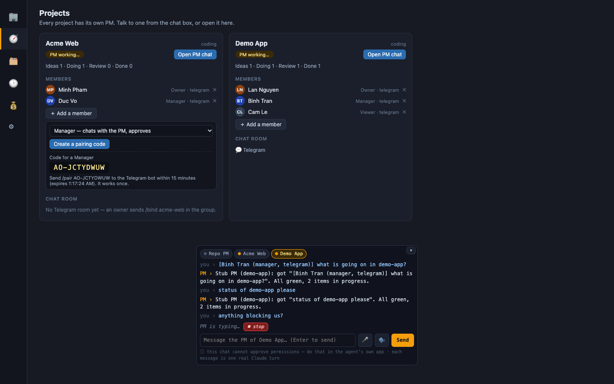
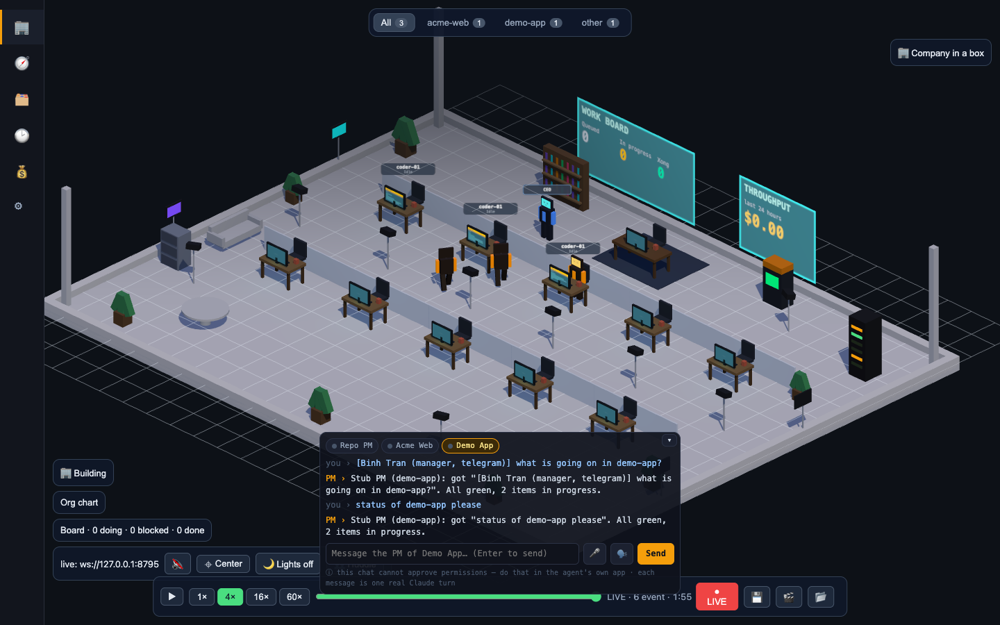

# One PM per project, several people, Telegram as a control room

Agent Office can run many projects at once. Each project has its **own PM** (a Claude
session in the project's folder), its **own members**, and optionally its own **Telegram
room**. Nothing here needs an inbound port: the bot long-polls Telegram over outbound HTTPS.



## Concepts

| Thing | Where it lives |
| --- | --- |
| Project PM | one `claude` process per project, session saved in `~/.agent-office/projects/<slug>/pm-session.json` |
| Members | `project.json` → `members: [{ id, name, role, telegram?: { userId }, zalo?: { userId } }]` |
| Chat room | `project.json` → `channels: { telegram: { chatId } }` (set with `/bind`) |
| Pairing codes | in memory only, one-time, 15 minutes |

The chat box has one chip per project PM (pulsing dot while it works, red badge for replies you have not read):



PMs of different projects run **at the same time**. Inside one project messages **queue**
(max 5 waiting) and run one after another on the same warm process.

## Roles

| Role | Can do |
| --- | --- |
| `owner` | everything: talk to the PM, approve/deny, add/remove members, bind a chat |
| `manager` | talk to the PM, approve/deny (unless the project's policy mode is `read-only`/`deny`) |
| `viewer` | `/status`, `/items`, `/projects` — nothing that costs tokens or changes anything |

A person who is not a member of the project a chat is about gets **no reply at all** (the only
door is a pairing code, and wrong guesses are throttled: 5 per 10 minutes per person).

## Adding a person (pairing)

1. An owner opens **Projects** in the office, clicks **Add a member**, picks a role,
   **Create a pairing code**.
2. The new person sends `/pair AO-XXXXXXXX` to the bot (pasting the bare code works too).
3. They are now a member with that role. The code is used up.

Codes live only in daemon memory: a restart invalidates them.

## Approve from your phone in one command

```
ao approvals setup            # (a) daemon up? (b) hook in ~/.claude/settings.json (c) bot token (d) pair (e) test approval
ao approvals setup --dry-run  # writes no file and sends no test approval; still asks the daemon (creates a pairing code). Needs a test daemon: --port N, not 8787
ao approvals remove           # take the hook out again
```

What it does to `~/.claude/settings.json`: it shows the exact `PermissionRequest` hook block, asks, saves a
timestamped backup (`settings.json.ao-backup-…`) and merges the block in without touching any other key or hook.
If the file is not valid JSON it stops and changes nothing. `--yes` skips the question. The file is rewritten as
2-space JSON. The bot token is read from the daemon's environment; the command can check a token you have at
hand (environment or a hidden prompt) against Telegram but never prints or stores it. Pairing uses the same
one-time code as below. The test approval is a harmless `echo`; if it comes back instantly, a project policy in
`auto` mode probably answered it instead of you. Verified against a fake Telegram server only; not yet against a
live bot (see the handover note for the 5-line check).

## Telegram setup

1. Create a bot with @BotFather, put the token in the daemon's environment:
   `TELEGRAM_BOT_TOKEN=...` (never in a file you commit; `sv run` is the usual way).
2. To use a group as a project's room: add the bot to the group. **Turn off privacy mode**
   in BotFather (`/setprivacy` → Disable), otherwise Telegram only delivers `/commands` to
   the bot and plain messages never reach the PM.
3. An owner of the project sends `/bind <project>` in that group. From then on messages in
   the group go to that project's PM, the PM's answer comes back to the group, approvals and
   the daily digest are posted there. `/unbind` undoes it.
4. A DM works too: with several projects, pick one with `/use <project>`.

`TELEGRAM_CHAT_ID` (the old single-chat setting) still works: that chat is trusted as owner of
every project and plain text there still reaches the default repo PM unless you `/use` a project.

### Commands

| Command | Who | |
| --- | --- | --- |
| `/projects` | members | your projects, role, PM state |
| `/status [project]` | members | PM state, item counts, pending approvals |
| `/items [project]` | members | open work items |
| plain text | owner, manager | goes to the project's PM |
| `/stop` | owner, manager | stop the PM's current turn |
| `/pending` | owner, manager | open approvals with their ids |
| `/approve <id>` `/deny <id>` | owner, manager | answer an approval (8-char id from the alert or `/pending`) |
| `/use <project>` | members | which project this chat is about |
| `/bind <project>` `/unbind` | owner | make this chat the project's room |
| `/pair <code>` | anyone | join a project |
| `/whoami` `/help` | members | |

When an agent in a project asks for a permission, the project's room gets
`⚠ Approval needed … /approve a1b2c3d4 · /deny a1b2c3d4`. Without a bound room the owners' and
managers' own DMs get it.

**Approvals wait up to ~2 minutes.** Each approval message carries **✓ Allow / ✗ Deny** buttons;
a tap sends the same `/approve <id>` / `/deny <id>` a person would type, so the same role and
policy checks apply. The approve gateway answers "ask in the terminal" after `APPROVAL_TTL_MS`
(default 115 s), just under its own fetch abort (118 s) and the hook's registered timeout
(`"timeout": 120`). Lower all three together if you want the terminal dialog back sooner. A
phone-only owner counts as "someone is watching", so approvals are no longer skipped when no
browser tab is open.

**What a manager can do.** Approving a tool call lets the PM run it on this machine, so a manager
is trusted with that project's folder — and with anything the PM's user account can read (the PM's
environment is scrubbed of the bot token, but not of files such as a service env file). Give the
manager role to people you would give a shell to; use `viewer` otherwise, or set the project's
policy mode to `read-only`, which stops managers from approving remotely.

### Personal-data shield (`piiGuard`)

For a project that handles customers' personal data, set `"policy": { "piiGuard": true }` in its `project.json`
(owner only to turn it off). Then everything the daemon sends to Telegram or Zalo for that project passes a
masker first: PM replies, approval alerts (and `/pending`), `/status`, the daily digest, and the notification push.
Masked: Vietnamese phone numbers (`0912 345 678`, `+84 (0) 912…`, `0084…`, written with spaces, tabs, dots, dashes,
slashes, brackets, invisible characters or full-width digits), CCCD (12 digits) and CMND (9 digits, also `123.456.789`)
numbers, e-mail addresses. Only the last 2-3 characters stay: `[phone ***678]`. The shield searches a normalised copy of
the text but replaces the matched value in the original, so nothing else in the message is rewritten. The count of
masked values (never the values) goes to `projects/<slug>/pii-audit.jsonl`.

**Cuts.** Text is masked as a whole BEFORE it is shortened, so a value cannot straddle a cut. Text that arrives already
cut (the approval preview, the transcript detail every adapter shortens, the PM's last reply) carries a trailing `…`
or is a known length; in a masked chat every line ending in `…` drops its half-cut last word and any trailing run of
digits. This applies to ALL text sent to a masked chat, whichever project it came from.

It applies to the project's bound room, to the private chat of each member, and to the operator's own chat while
any project has the shield on (that chat is trusted as owner of every project, so it may receive any project's text).
**If the project list or a `project.json` cannot be read, everything is masked** (one warning in the log) rather than
nothing.

**Limits, plainly.** It matches shapes, so it cannot find a person's name or an address, nor digits spelled out
in words, nor a number split by letters. It can mask a harmless number that looks like an ID (a plain 9-digit
counter) or a UUID/long number that happens to contain a phone-shaped run. A line that really ends in "…" loses its
last word even when nothing was cut. Digit groups separated by 4 or more blanks in a row are not seen. When in doubt it masks.
A hand-written `"piiGuard": "true"` or `1` counts as ON (anything but absent, null or false does). It guards what goes to chat only: the model provider still receives whatever
the agents read, and the PM's own transcript on this machine is not changed. It does **not** block a worker lane:
`allowedHarnesses` only warns (below), because a session that already runs cannot be stopped from here.

### End-of-day digest

Every day at `AO_DIGEST_TIME` (local, default `18:00`; `AO_DIGEST=0` turns it off) each project
with a bound room gets: what finished today, what is in progress/review, approvals waiting, the
PM's last reply and — if the radar lane's `GET /metrics/intervention?project=<slug>` exists —
the time-to-intervene line. Missing endpoint = line omitted. A project without a room gets
nothing. One digest per project per day (remembered across restarts).

## Channels

Telegram and Zalo share one router (`channel-router.js`): a transport turns an update into
`{ channel, chatId, userId, name, text, isGroup }` and the router does identity, roles, rate
limits and replies. Zalo stays asleep until `ZALO_OA_TOKEN`, `ZALO_APP_ID` and `ZALO_OA_SECRET`
are all set; its webhook is public, so a request without a valid `X-ZEvent-Signature` is dropped
(the signature recipe and API shapes are from Zalo's docs and **not verified against a live OA**).

Rate limits per person: 30 messages/min overall, 6/min to the PM; over the limit you get one
"slow down" per minute, the rest is dropped.

Secrets: the bot token is read from the environment only; every string that reaches a log is
scrubbed of it and a failure is logged once per outage, not once per retry.

## HTTP API (used by the office UI)

`GET /pms` · `GET /overview` · `GET /channels` · `GET /members?project=` ·
`POST /pm/send {project, text}` · `POST /pm/read {project}` · `POST /pm/stop {project}` ·
`POST /pairing {project, role}` / `GET /pairing?project=` · `POST /members/remove {project, id}`

Writes are gated by `roleOf(req)` from the access guard (`access.js`): loopback is `owner`; a LAN or tunnel caller carries the role of its access token. A caller **without** a token whose `Host` is a DNS name is refused (DNS-rebinding defence): loopback and IP addresses pass, other names must be listed in `AGENT_OFFICE_ALLOWED_HOSTS` (comma separated). A verified token holder may use any name (Tailscale MagicDNS, `office.local`, an HTTPS proxy).
New WS event types, both additive: `pm_message` (chat lines, replayed on reload) and
`pm_status` (live only).
