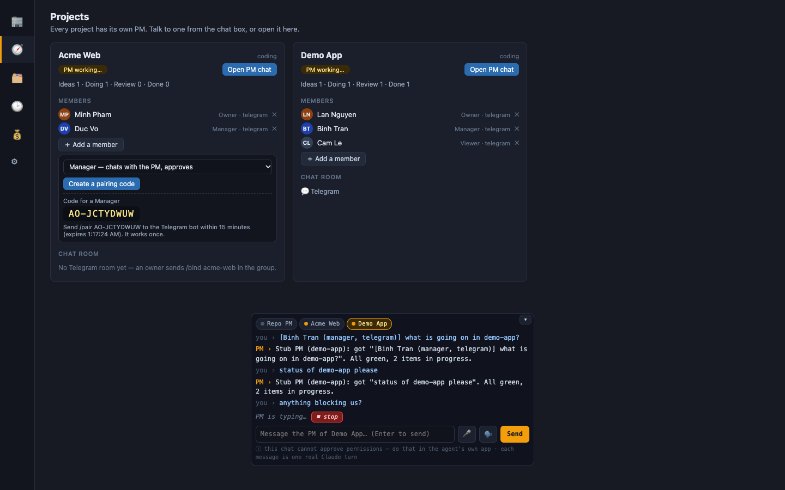
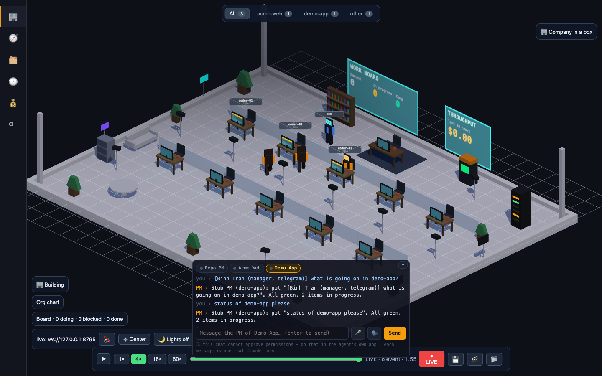

# One PM per project, several people, Telegram as a control room

Agent Office can run many projects at once. Each project has its **own PM** (a Claude
session in the project's folder), its **own members**, and optionally its own **Telegram
room**. Nothing here needs an inbound port: the bot long-polls Telegram over outbound HTTPS.

## Concepts

| Thing | Where it lives |
| --- | --- |
| Project PM | one `claude` process per project, session saved in `~/.agent-office/projects/<slug>/pm-session.json` |
| Members | `project.json` → `members: [{ id, name, role, telegram?: { userId }, zalo?: { userId } }]` |
| Chat room | `project.json` → `channels: { telegram: { chatId } }` (set with `/bind`) |
| Pairing codes | in memory only, one-time, 15 minutes |

The chat box has one chip per project PM (pulsing dot while it works, red badge for replies you have not read):

PMs of different projects run **at the same time**. Inside one project messages **queue**
(max 5 waiting) and run one after another on the same warm process.

## Roles

| Role | Can do |
| --- | --- |
| `owner` | everything: talk to the PM, approve/deny, add/remove members, bind a chat |
| `manager` | talk to the PM, approve/deny (unless the project's policy mode is `read-only`/`deny`) |
| `viewer` | `/status`, `/items`, `/projects` — nothing that costs tokens or changes anything |

A person who is not a member of the project a chat is about gets **no reply at all** (the only
door is a pairing code, and wrong guesses are throttled: 5 per 10 minutes per person).

## Adding a person (pairing)

1. An owner opens **Projects** in the office, clicks **Add a member**, picks a role,
   **Create a pairing code**.
2. The new person sends `/pair AO-XXXXXXXX` to the bot (pasting the bare code works too).
3. They are now a member with that role. The code is used up.

Codes live only in daemon memory: a restart invalidates them.

## Telegram setup

1. Create a bot with @BotFather, put the token in the daemon's environment:
   `TELEGRAM_BOT_TOKEN=...` (never in a file you commit; `sv run` is the usual way).
2. To use a group as a project's room: add the bot to the group. **Turn off privacy mode**
   in BotFather (`/setprivacy` → Disable), otherwise Telegram only delivers `/commands` to
   the bot and plain messages never reach the PM.
3. An owner of the project sends `/bind <project>` in that group. From then on messages in
   the group go to that project's PM, the PM's answer comes back to the group, approvals and
   the daily digest are posted there. `/unbind` undoes it.
4. A DM works too: with several projects, pick one with `/use <project>`.

`TELEGRAM_CHAT_ID` (the old single-chat setting) still works: that chat is trusted as owner of
every project and plain text there still reaches the default repo PM unless you `/use` a project.

### Commands

| Command | Who | |
| --- | --- | --- |
| `/projects` | members | your projects, role, PM state |
| `/status [project]` | members | PM state, item counts, pending approvals |
| `/items [project]` | members | open work items |
| plain text | owner, manager | goes to the project's PM |
| `/stop` | owner, manager | stop the PM's current turn |
| `/pending` | owner, manager | open approvals with their ids |
| `/approve <id>` `/deny <id>` | owner, manager | answer an approval (8-char id from the alert or `/pending`) |
| `/use <project>` | members | which project this chat is about |
| `/bind <project>` `/unbind` | owner | make this chat the project's room |
| `/pair <code>` | anyone | join a project |
| `/whoami` `/help` | members | |

When an agent in a project asks for a permission, the project's room gets
`⚠ Approval needed … /approve a1b2c3d4 · /deny a1b2c3d4`. Without a bound room the owners' and
managers' own DMs get it.

**Heads-up — approvals are short-lived.** The approve gateway answers "ask in the terminal"
after `APPROVAL_TTL_MS` (default 25 s, shorter than the hook's own timeout). Answering from a
phone in 25 s is tight; raise both (hook timeout and `APPROVAL_TTL_MS`) if remote approval is
the point. A phone-only owner counts as "someone is watching", so approvals are no longer
skipped when no browser tab is open.

**What a manager can do.** Approving a tool call lets the PM run it on this machine, so a manager
is trusted with that project's folder — and with anything the PM's user account can read (the PM's
environment is scrubbed of the bot token, but not of files such as a service env file). Give the
manager role to people you would give a shell to; use `viewer` otherwise, or set the project's
policy mode to `read-only`, which stops managers from approving remotely.

### End-of-day digest

Every day at `AO_DIGEST_TIME` (local, default `18:00`; `AO_DIGEST=0` turns it off) each project
with a bound room gets: what finished today, what is in progress/review, approvals waiting, the
PM's last reply and — if the radar lane's `GET /metrics/intervention?project=<slug>` exists —
the time-to-intervene line. Missing endpoint = line omitted. A project without a room gets
nothing. One digest per project per day (remembered across restarts).

## Channels

Telegram and Zalo share one router (`channel-router.js`): a transport turns an update into
`{ channel, chatId, userId, name, text, isGroup }` and the router does identity, roles, rate
limits and replies. Zalo stays asleep until `ZALO_OA_TOKEN`, `ZALO_APP_ID` and `ZALO_OA_SECRET`
are all set; its webhook is public, so a request without a valid `X-ZEvent-Signature` is dropped
(the signature recipe and API shapes are from Zalo's docs and **not verified against a live OA**).

Rate limits per person: 30 messages/min overall, 6/min to the PM; over the limit you get one
"slow down" per minute, the rest is dropped.

Secrets: the bot token is read from the environment only; every string that reaches a log is
scrubbed of it and a failure is logged once per outage, not once per retry.

## HTTP API (used by the office UI)

`GET /pms` · `GET /overview` · `GET /channels` · `GET /members?project=` ·
`POST /pm/send {project, text}` · `POST /pm/read {project}` · `POST /pm/stop {project}` ·
`POST /pairing {project, role}` / `GET /pairing?project=` · `POST /members/remove {project, id}`

Writes are gated by `roleOf(req)` (platform lane); until that is wired every caller is `owner` (the daemon is loopback-only and the origin guard refuses remote pages — the trust model every other office route already has). Every route above also refuses a request whose `Host` is a DNS name (DNS-rebinding defence): loopback and IP addresses pass, anything else must be listed in `AGENT_OFFICE_ALLOWED_HOSTS` (comma separated).
New WS event types, both additive: `pm_message` (chat lines, replayed on reload) and
`pm_status` (live only).
