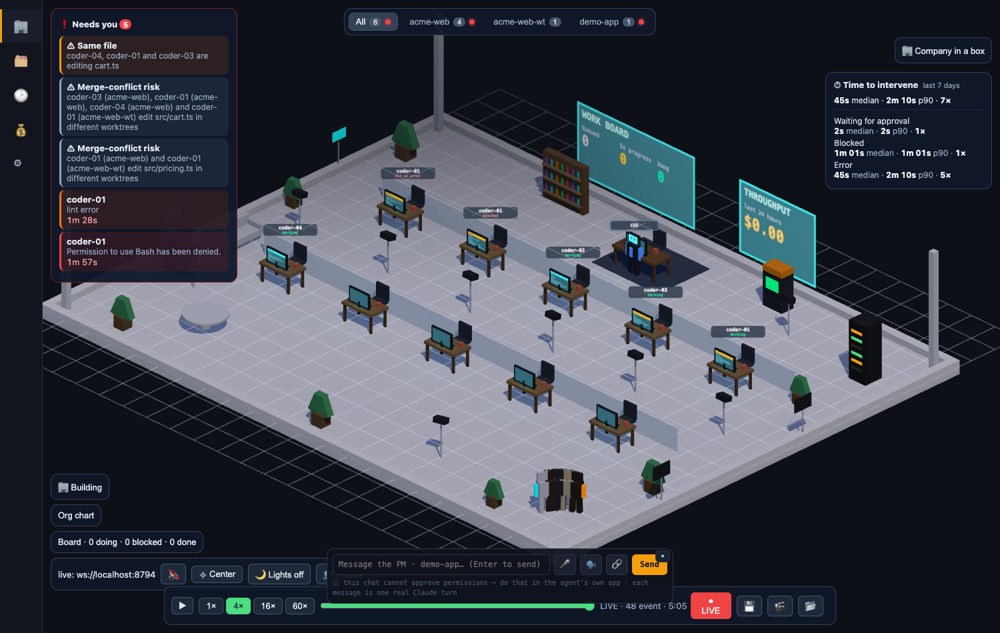

# Radar: collisions, time-to-intervene, open the right session

Three small features that answer "who is stepping on whom, how long did the
agents wait for me, and how do I get into that session?". All three read the
same normalized event stream the office already uses; none of them can block or
change an agent.



## 1. Collision radar

The new routes (`/radar*`, `/metrics/intervention`, `/sessions/open-terminal`) send no CORS headers: the office page is served by the daemon itself (same origin), and the existing origin guard refuses cross-origin callers.

The daemon keeps, per file, the agents that recently set out to write it
(Claude `Edit`/`Write`/`MultiEdit`/`NotebookEdit`, Codex `apply_patch` in any of
its shapes, Gemini `write_file`/`replace`). Each tool-call start event carries
`meta.paths` (additive field, see `src/touched-paths.js`).

| Alert | When | Severity | Desktop notification |
|---|---|---|---|
| `file` | two sessions that are **not** in one parent/child tree write the same absolute path within the window | hard | yes |
| `worktree` | same repo, different worktrees, same repo-relative path (a merge conflict in waiting) | soft | no |
| `worker` | two `claude-worker` sessions on one repo (house rule: one worker per repo) | hard | yes |

The `worker` rule keys on `harness === "claude-worker"` (and `lane` for the
resume command). Nothing in the event stream emits that harness yet — the
multi-harness lane (L3) must; until then this rule is covered by unit tests only.

- "Same tree" = a session and its sub-agents (Claude `parentId` chain, Codex
  `parent_thread_id`). They never collide with each other.
- A session that ends (`session_end`, which today means the 5-minute inactivity
  timeout, so an idle agent's touches really expire after ~5 min) drops its touches, so a hand-over from one
  agent to the next is not a collision. Alerts found while replaying old
  history after a daemon restart are listed but do not notify again.
- One alert per (kind, file): a third agent joining updates the open alert.
  It closes (`collision_resolved`) when fewer than two trees are still active
  on that file.
- Worktrees are recognised from git itself (a linked worktree's `.git` file
  points into the main repo), so it also works for worktrees outside
  `.claude/worktrees/`.
- Alerts are events `collision_alert` / `collision_resolved` on the normal
  stream, listed in the **intervention queue** ("Needs you"), and served again
  by `GET /radar` for pages that connect later.

Tuning: `AGENT_OFFICE_RADAR_TTL_MS` (default 600000 = 10 min) is the window a
touch counts; `AGENT_OFFICE_NOTIFY=0` silences the desktop notification.

### Ask before editing: `who_is_touching`

The office MCP server (the one that already serves the PM chat's permission
tool, `hooks/approval-mcp.mjs`) has a second tool, `who_is_touching(path)`. It
answers in plain text with the other agents that wrote the file recently and
the agents that wrote the same file in another worktree.

PM chat sessions get it automatically. To give it to any Claude Code session,
register the server once (adjust the path to where this repo lives):

```bash
claude mcp add office -- node /path/to/agent-office/packages/daemon/hooks/approval-mcp.mjs
```

(`AGENT_OFFICE_PORT` selects the daemon port, default 8787.) Then tell the
agent in its instructions: *"before editing a shared file, call
`who_is_touching`."*

### Optional warning hook (not installed for you)

`packages/daemon/hooks/pre-edit-radar.mjs` is a **sample PreToolUse hook that
only warns**. Before an `Edit`/`Write`/`MultiEdit` it asks the radar and, if
someone else touched the file, prints a message for the agent and for you. It
never sets a permission decision, always exits 0, and gives up after 1.5 s, so
a stopped daemon cannot slow an edit down.

To enable it, add this to `.claude/settings.json` (one project) or
`~/.claude/settings.json` (everywhere):

```json
{
  "hooks": {
    "PreToolUse": [
      {
        "matcher": "Edit|Write|MultiEdit|NotebookEdit",
        "hooks": [
          { "type": "command", "command": "node /path/to/agent-office/packages/daemon/hooks/pre-edit-radar.mjs" }
        ]
      }
    ]
  }
}
```

Nothing in this repo edits your settings for you.

## 2. Time-to-intervene

An **episode** starts when an agent needs a person and ends when that is
lifted:

| Kind | Starts | Ends |
|---|---|---|
| `waiting_permission` | hook signal "waiting for approval", or an office approval request | you approve/deny it in the office, or the hook says the agent proceeds |
| `blocked` | a tool error that says the permission was denied | the agent's next event |
| `error` | any other failing tool call | the agent's next event |

Durations use event timestamps, so replaying transcripts at boot reproduces the
same episodes (ids are deduplicated against what is on disk). Approvals that
expire with nobody deciding do not close an episode: the terminal dialog is
still waiting. A session that ends while stuck records nothing.

Stored per local day (the day it was resolved), one line per episode, no paths
or text, in
`<AGENT_OFFICE_HOME or ~/.agent-office>/metrics/intervention/YYYY-MM-DD.jsonl`.
Ninety days are kept (older day files are deleted on start).

```
GET /metrics/intervention?days=7&project=<slug-or-repo>&kind=<kind>&date=YYYY-MM-DD
```

```json
{
  "generatedAt": 1790000000000,
  "window": { "from": "2026-10-21", "to": "2026-10-27", "days": 7 },
  "filters": { "project": null, "kind": null },
  "total": { "count": 12, "medianMs": 42000, "p90Ms": 185000, "totalMs": 410000 },
  "byKind": { "waiting_permission": { "count": 8, "medianMs": 61000, "p90Ms": 240000, "totalMs": 0 } },
  "byProject": { "acme-web": { "count": 9, "medianMs": 0, "p90Ms": 0, "totalMs": 0 } },
  "byDay": [ { "date": "2026-10-27", "count": 4, "medianMs": 0, "p90Ms": 0, "totalMs": 0, "byProject": {} } ],
  "open": 1
}
```

`median` is the mean of the middle pair when the count is even; `p90` is
nearest-rank. Projects come from `~/.agent-office/projects/<slug>/project.json`
(`cwd` and everything under it, worktrees included); a session no project
claims is grouped by repo name. The small card at the top right of the office
shows median, p90 and count for the last 7 days, per kind.

Known limits:

- A tool error the model recovers from within seconds is still an `error`
  episode. The per-kind rows keep those apart from permission waits.
- A permission wait is kept open across the 5-minute inactivity `session_end`
  (a permission prompt writes no transcript line, so that timeout fires while
  you are still being waited on); a stuck `error` on a timed-out session is
  dropped.
- A wait ends on the first later event of the same agent, so a sibling tool
  result from a parallel call can end it a little early.

## 3. Open the right session

Click a character; the side panel has an **Open this session** row:

- **Copy resume command** — `cd "<cwd>" && claude --resume <id>`,
  `codex resume <id>` for Codex, and `claude-<lane> --resume <id>` for a worker
  session whose lane is known. (Windows paths get `cd /d`.)
- **Open terminal here** — `POST /sessions/open-terminal {agentId}`. The folder
  is never taken from the request: the daemon uses the working directory it
  observed for that agent.
- **Open in Claude desktop** — `claude://resume?session=<id>`, Claude sessions
  only.

The Claude desktop link was checked against real data on a machine that uses
the app: the transcript session id the daemon tails is exactly the
`cliSessionId` stored in every desktop session's metadata, and the app's
`resume` deep-link handler takes a CLI session UUID and imports that session.
The link has not been click-tested end to end (importing a session changes the
state of the desktop app).
